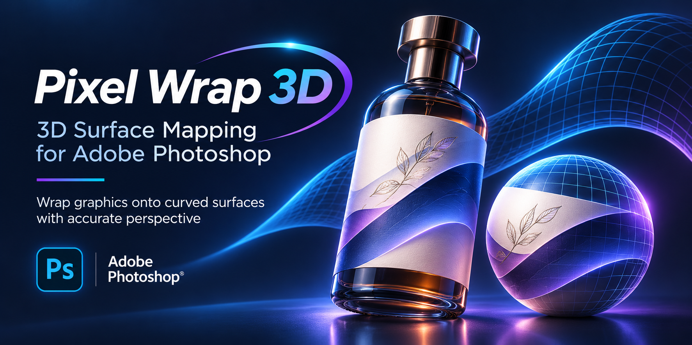
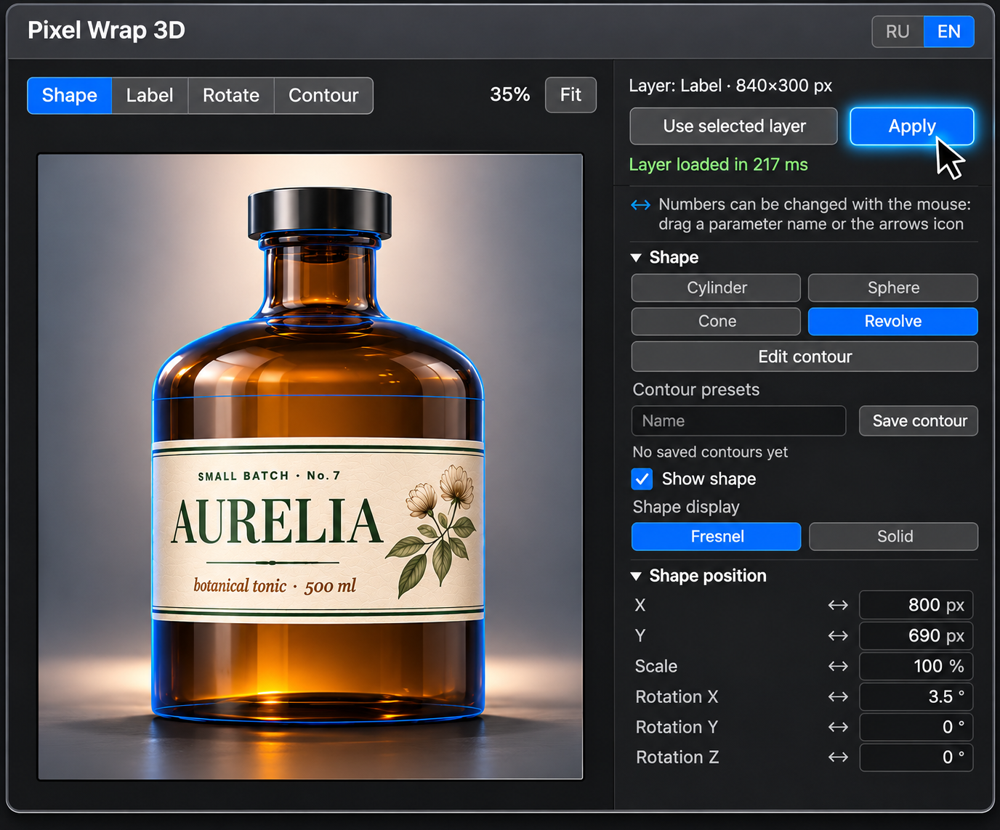
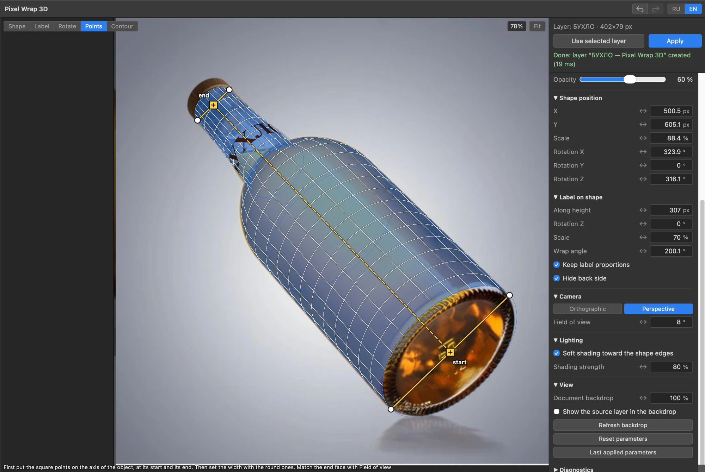
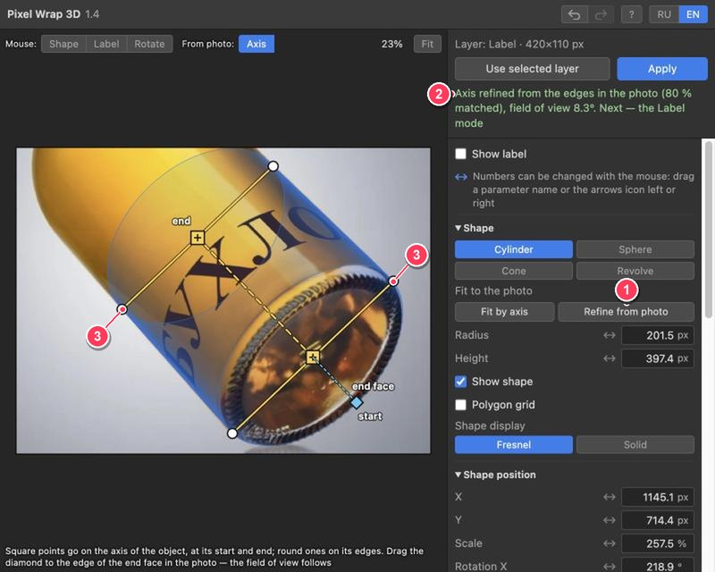
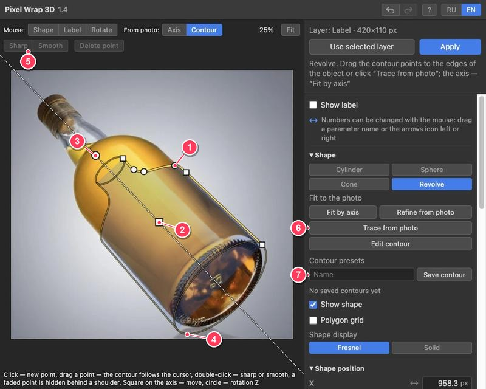
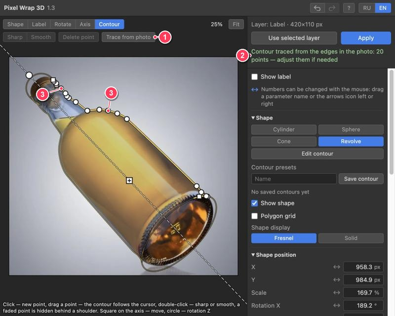
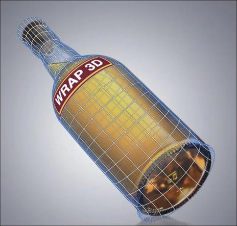
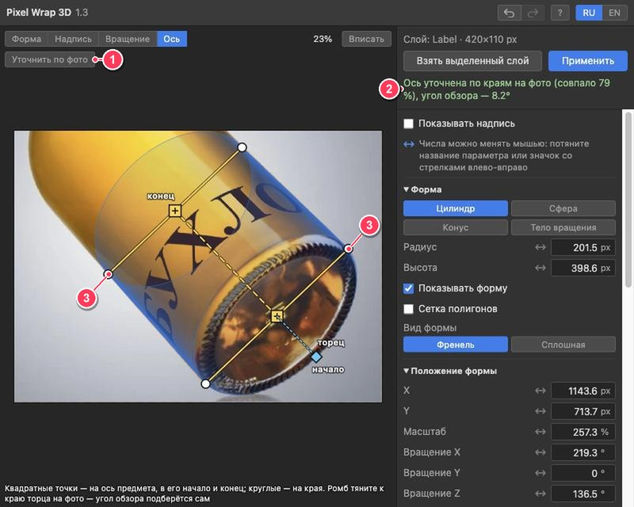
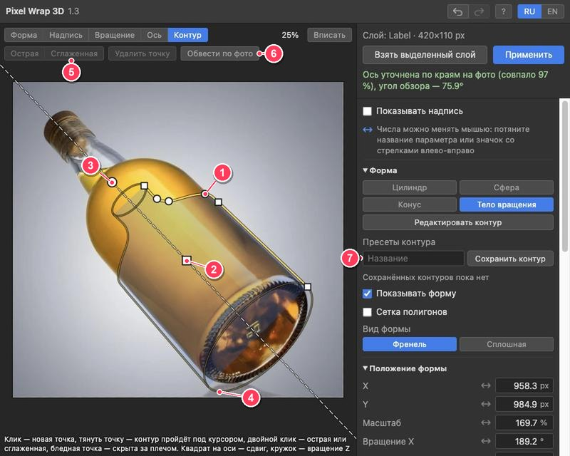
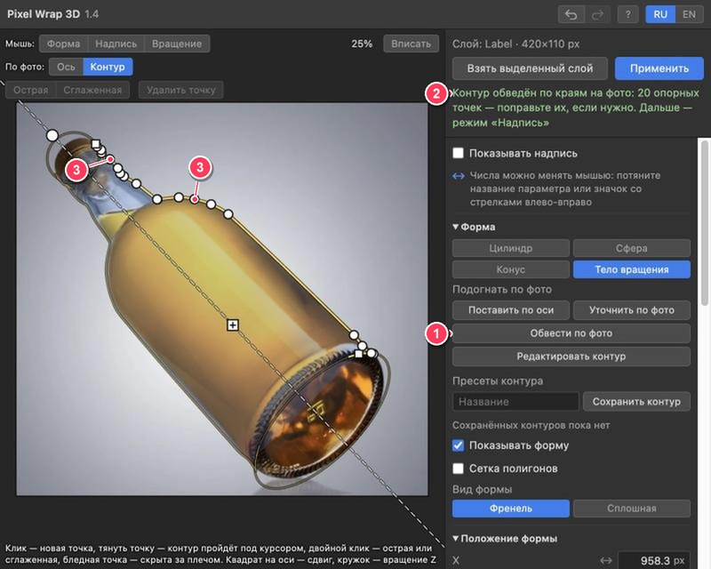

# Pixel Wrap 3D

**3D Surface Mapping for Adobe Photoshop**

A Photoshop plugin that wraps a label or a logo around a 3D shape and puts the result back into the document as a layer. Photoshop's own 3D layers are gone, and **Edit ▸ Transform ▸ Warp ▸ Cylinder** gives you very little to work with. Pixel Wrap 3D gives you a real form to match against the photo: a cylinder, a sphere, a cone, or a body of revolution you draw yourself.

**[Download the latest release](https://github.com/Toys-D/PixelWrap3D/releases/latest)** · Photoshop 2025 (26.0) or newer · free · [how to install](#install)

**At work in Photoshop:** the shape is matched to the bottle in the photo, the label wraps around it and comes back as a new layer.

## What it does

- **Any layer as the source.** Text, a logo, a smart object: the selected layer is taken with its transparency.
- **Four shapes.** Cylinder, sphere, truncated cone, and a body of revolution built from a contour you draw.
- **A contour editor.** Half of the profile over a snapshot of your document, shown the way the camera sees it, rotations and perspective included, so you can trace a bottle turned towards the viewer right over the photo. **Trace from photo** does it for you: it finds the edges of the object along the axis and builds the contour, which you can then adjust. Add, move and delete points, switch each one between sharp and smooth, move and rotate the axis. Contours are saved as presets.
- **Placement on the shape.** Position along the height and around the shape, rotation of the label itself on the surface to lay it sideways or turn it upside down, scale, wrap angle. The part of the label that goes behind the shape is hidden, with a switch to show it.
- **Matching the photo.** The document shows through the viewport. Move and scale the shape, rotate it around the X, Y and Z axes of the scene, a full circle on every axis; with the mouse it also turns around its own axes, and its X, Y and Z axes show at its centre while it turns; choose an orthographic or a perspective camera and its field of view. Every parameter has a number field, and every number can be dragged with the mouse.
- **Fit by the axis.** Click **Fit by axis** in the **Shape** group (or **Axis** at the top, under **From photo**), put the two axis points on the object, at its start and its end, then set the width at each end with the side points. The plugin works out the position, scale, rotations and length of the shape from them, perspective included. Drag the diamond to the edge of the end face in the photo and the field of view is worked out too; set it by hand, and the shape re-fits to the same points. **Refine from photo** finishes a roughly placed axis by itself: it finds the edges of the object next to the shape and fits the axis, the width and, when it finds the edge of the bottom, the field of view to them. Works for a cylinder, a cone and a body of revolution (for the latter it pulls the axis and the points of the contour you set to the edges), best when the object stands out from the background.
- **Undo and redo inside the panel.** Cmd/Ctrl+Z steps back, Shift+Cmd+Z or Ctrl+Y steps forward; the two arrows in the panel header do the same. One step is one finished action: a drag, a number, a moved point. Apply is a step in Photoshop's own history and is undone there.
- **Shape only.** Untick **Show label** at the top of the panel to hide the label while you match the shape to the photo. Apply still renders it.
- **Polygon grid.** A switch draws a grid on the shape, so its rotation and perspective are easy to read. It works with the shape shown or hidden and never gets into the result.
- **Honest colours.** No shading by default: the pixels of your layer pass through unchanged. Soft shading toward the edges of the shape is optional.
- **Sits on the photo.** Before inserting, Apply asks two things: whether to give the new layer the **Multiply** blend mode, so a dark label takes the light and shadow of the photo, and whether to blur it by a few pixels to match the sharpness of the photo. Both are off by default, and the choice is remembered.
- **Back into the document.** Rendered at document resolution on a transparent background and placed as a new layer exactly where it belongs, in a single history step. The shape itself never gets into the result. Large documents render only the label area, in tiles when it exceeds the WebGL limits.
- **Picks up where you left off.** The scene of the last Apply is restored when you open the panel again.
- **Languages.** English and Russian. The panel follows Photoshop's language; switch it with **RU / EN** in the panel header.
- **Stays offline.** three.js is bundled with the plugin. Nothing is loaded from the network.

## See it in action

<table>
<tr>
<td width="50%" valign="top"> <b>Refine from photo.</b> Put the axis roughly, and the plugin finds the edges of the bottle and fits the axis, the width and the field of view to them.</td>
<td width="50%" valign="top"> <b>The contour editor.</b> Half of the profile over the photo, in perspective: drag the points to the edges, move and turn the axis.</td>
</tr>
<tr>
<td width="50%" valign="top"> <b>Trace from photo.</b> The contour follows the edges of the bottle by itself, shoulders and neck included; adjust it if needed.</td>
<td width="50%" valign="top"> <b>Any profile.</b> The label wraps around the body of revolution built from that contour, perspective included.</td>
</tr>
</table>

The numbered marks are explained in the [step-by-step guide](docs/HELP.md).

## Install

Pixel Wrap 3D is not on the Adobe Marketplace, so you install it from a file. There are two ways:

- **The `.ccx` file** is the easy way, for everyone. Double-click it, and the plugin is installed for good, like a plugin from the Marketplace.
- **UXP Developer Tools** is Adobe's tool for plugin developers. Use it if the `.ccx` file does not install on your computer, or if you already work with it.

Use one way, not both at once.

**You need** Photoshop 2025 (26.0) or newer and the Creative Cloud desktop app, signed in with your Adobe ID. The app comes with Photoshop.

### Way 1: the .ccx file (recommended)

1. On the [releases page](https://github.com/Toys-D/PixelWrap3D/releases/latest) download **`PixelWrap3D-<version>.ccx`**.
2. Double-click the downloaded file. The Creative Cloud app opens.
3. It shows **Install a non-marketplace plugin** and warns that the plugin comes from a third-party developer. Press **Install**. Your system may ask for your administrator password.
4. Wait for the message that the plugin is installed.
5. In Photoshop open **Plugins ▸ Pixel Wrap 3D**. If the panel is not in the menu, restart Photoshop.

Developer mode is not needed, and the plugin stays installed after Photoshop restarts.

- **Update.** Download the new `.ccx` and double-click it. Creative Cloud asks **Replace current version?**: press **Continue**.
- **Disable or uninstall.** In the Creative Cloud app open **Stock & Marketplace ▸ Plugins ▸ Manage plugins**, press **•••** next to Pixel Wrap 3D and choose **Disable** or **Uninstall**. Uninstalling also deletes the plugin's data: saved contour presets and settings. If Photoshop is open, Creative Cloud asks you to close it first.
- **If it does not install,** Creative Cloud shows a red message; open its details to see the reason. If that does not help, use Way 2 and tell me in an [issue](https://github.com/Toys-D/PixelWrap3D/issues).

### Way 2: UXP Developer Tools

A plugin loaded this way stays only until Photoshop quits: after every restart of Photoshop load it again (steps 4 and 6).

1. On the [releases page](https://github.com/Toys-D/PixelWrap3D/releases/latest) download **`PixelWrap3D-<version>.zip`** and unpack it into a folder you will keep: the plugin is loaded from there.
2. In Photoshop open **Photoshop ▸ Preferences ▸ Plugins** on macOS (some versions call it **Settings**) or **Edit ▸ Preferences ▸ Plugins** on Windows, tick **Enable Developer Mode** and restart Photoshop.
3. Install **UXP Developer Tools** from the Creative Cloud app.
4. Start Photoshop, then UXP Developer Tools.
5. Press **Add Plugin** and choose `manifest.json` in the unpacked `PixelWrap3D` folder.
6. In the Pixel Wrap 3D row press **••• ▸ Load**.
7. In Photoshop open **Plugins ▸ Pixel Wrap 3D**.

**Update.** Unpack the new archive, press **••• ▸ Unload**, add the new `manifest.json` with **Add Plugin** and load it with **••• ▸ Load**. Saved contour presets and the last scene carry over.

### Files in a release

| File | What it is for |
|---|---|
| `PixelWrap3D-<version>.ccx` | Way 1: install with a double-click |
| `PixelWrap3D-<version>.zip` | Way 2: the plugin folder for UXP Developer Tools |
| `SHA256SUMS.txt` | Checksums, to make sure a download is not damaged |

## How to use it

1. Select the layer with the label and press **Use selected layer**.
2. Pick a shape and match it to the object in the photo: drag it in the viewport, or set the numbers on the right.
3. Switch the mouse mode to **Label** to turn the label around the axis and move it along the height.
4. Press **Apply**. The wrapped label appears as a new layer above the original.

A step-by-step guide with pictures is built into the plugin — the **?** button in the panel header — and is also here: [docs/HELP.md](docs/HELP.md).

## Good to know

- Works with **RGB** documents. Tested on 8-bit documents in Photoshop 26.2 on macOS (Apple Silicon). Nothing in the code is tied to the Mac, but Windows has not been tested yet.
- The contour editor does not hide parts of the shape covered by other parts: a neck behind a shoulder is still drawn.
- The result area is limited to 64 megapixels.

## Under the hood

- **The UXP side is thin.** It reads layer pixels and writes the result through Photoshop's Imaging API, and keeps settings and presets in the plugin's data folder.
- **The interface and the 3D render live in a WebView** with local HTML, drawn with three.js. The scene is measured in document pixels, so any rectangle of the document can be rendered one to one.
- **Pixels travel as base64 strings** over `postMessage`, in chunks: the bridge between UXP and a WebView carries JSON only. Sixteen megabytes take about 50–200 ms.

## Support the project

Pixel Wrap 3D is free. I build it alone, in my spare time. If it saves you time, support it: that is what lets me spend more of mine on it.

**[Support via PayPal](https://www.paypal.com/cgi-bin/webscr?cmd=_xclick&business=pixmap1981%40gmail.com&item_name=Pixel+Wrap+3D&currency_code=USD)** · Support is voluntary; nothing in the plugin depends on it.

## Get in touch

Bugs, questions, wishes: **[pixmap1981@gmail.com](mailto:pixmap1981@gmail.com?subject=Pixel%20Wrap%203D)**, or open an [issue](https://github.com/Toys-D/PixelWrap3D/issues).

## License

Copyright © 2026 Pixmap Labs. All rights reserved.

Pixel Wrap 3D is freeware. You may download it and use it free of charge, for personal and commercial work. You may not modify, decompile or redistribute it; to share it, share the link to this page. The full terms are in [LICENSE](LICENSE).

Versions up to 1.2.2 were released under GNU GPL v3, and copies of those versions remain under it.

The plugin includes [three.js](https://threejs.org) under the MIT License; its notice comes with the plugin in `THIRD-PARTY-NOTICES.txt`.

Adobe and Photoshop are trademarks of Adobe Inc. Pixel Wrap 3D is an independent plugin; its name and visuals do not imply affiliation with or endorsement by Adobe.

---

## По-русски

Плагин для Photoshop, который натягивает надпись или логотип на 3D-форму и возвращает результат в документ слоем. Встроенных 3D-слоёв в Photoshop больше нет, а **Редактирование ▸ Трансформирование ▸ Деформация ▸ Цилиндр** даёт слишком мало настроек. Pixel Wrap 3D даёт настоящую форму, которую можно совместить с фото: цилиндр, сферу, конус или тело вращения по своему контуру.

**[Скачать последнюю версию](https://github.com/Toys-D/PixelWrap3D/releases/latest)** · Photoshop 2025 (26.0) и новее · бесплатно · [как установить](#установка)

Источник — выделенный слой с прозрачностью: текст, логотип, смарт-объект. Четыре формы: цилиндр, сфера, усечённый конус, тело вращения. Редактор контура поверх снимка документа показывает контур таким, каким его видит камера, — с вращениями и перспективой, так что бутылку, повёрнутую к зрителю, можно обвести прямо по фото, а кнопка «Обвести по фото» делает это сама — находит края предмета вдоль оси и строит по ним контур, который потом можно поправить; точки можно добавлять, двигать, удалять и делать острыми или сглаженными, ось — сдвигать и вращать; контуры сохраняются как пресеты. Надпись двигается по высоте и вокруг формы, поворачивается на самой поверхности — хоть набок, хоть вверх ногами, меняет масштаб и угол охвата; часть, уходящая назад, скрывается. Форму можно двигать, масштабировать и вращать вокруг осей сцены X, Y и Z на полный оборот, а мышью — и вокруг её собственных осей; пока форму вращают, в её центре видны оси X, Y и Z, камера ортогональная или перспективная с углом обзора; у каждого параметра есть числовое поле, и каждое число можно тянуть мышью. В режиме «Ось» — кнопка «Поставить по оси» в группе «Форма» или «Ось» вверху, в группе «По фото», — форму можно подогнать по фото: поставьте две точки оси — в начале предмета и в его конце, затем боковыми точками задайте ширину на каждом конце, и плагин сам посчитает положение, масштаб, вращения и длину формы вместе с перспективой; угол обзора подбирается сам, если потянуть ромб к краю торца на фото, или задаётся вручную — форма пересчитывается по тем же точкам. Кнопка «Уточнить по фото» доводит примерно выставленную ось сама: находит края предмета рядом с формой и ставит по ним ось, ширину, а если найдёт край донышка — и угол обзора; работает для цилиндра, конуса и тела вращения (у него подтягивает к краям ось и точки поставленного контура), лучше всего — когда предмет заметно отличается от фона. Действия в панели отменяются и возвращаются: Cmd/Ctrl+Z и Shift+Cmd+Z (или Ctrl+Y), те же две стрелки есть в шапке панели; «Применить» — это шаг в истории самого Photoshop, он отменяется там. Флажок «Показывать надпись» вверху панели убирает надпись из окна просмотра, пока форму совмещают с фото; в результат она попадает всё равно. Флажок «Сетка полигонов» рисует на форме сетку — по ней хорошо видны поворот и перспектива; в результат сетка не попадает. По умолчанию без затенения, цвета надписи не меняются; мягкое затенение к краям включается отдельно. Перед вставкой «Применить» спрашивает, поставить ли новому слою режим «Умножение» (тёмная надпись берёт свет и тень фото) и размыть ли надпись на несколько пикселей под резкость фотографии; по умолчанию оба пункта выключены, выбор запоминается. Результат рендерится в разрешении документа на прозрачном фоне и вставляется новым слоем точно на своё место одной записью в истории. При следующем открытии панели сцена последнего применения восстанавливается.

**Языки:** русский и английский. Панель берёт язык Photoshop, переключить можно кнопками **RU / EN** в её шапке.

<table>
<tr>
<td width="50%" valign="top"> <b>«Уточнить по фото».</b> Поставьте ось примерно — плагин сам найдёт края бутылки и подгонит по ним ось, ширину и угол обзора.</td>
<td width="50%" valign="top"> <b>Редактор контура.</b> Половина профиля поверх фото, в перспективе: тяните точки к краям, двигайте и поворачивайте ось.</td>
</tr>
<tr>
<td width="50%" valign="top"> <b>«Обвести по фото».</b> Контур сам проходит по краям бутылки — с плечами и горлышком; потом его можно поправить.</td>
<td width="50%" valign="top"> <b>Любой профиль.</b> Надпись ложится на тело вращения, построенное по этому контуру, вместе с перспективой.</td>
</tr>
</table>

Что значат номера на картинках, рассказано в [справке по шагам](docs/HELP.ru.md).

### Установка

Плагина нет в Adobe Marketplace, поэтому он ставится из файла. Способов два:

- **Файл `.ccx`** — самый простой, для всех. Двойной щелчок — и плагин установлен насовсем, как плагин из магазина Adobe.
- **UXP Developer Tools** — инструмент Adobe для разработчиков плагинов. Он пригодится, если `.ccx` на вашем компьютере не ставится или если вы уже им пользуетесь.

Пользуйтесь одним способом, а не двумя сразу.

**Что нужно:** Photoshop 2025 (26.0) или новее и приложение Creative Cloud, в котором вы вошли под своим Adobe ID. Приложение ставится вместе с Photoshop.

**Способ 1. Файл .ccx (рекомендуется)**

1. На [странице релизов](https://github.com/Toys-D/PixelWrap3D/releases/latest) скачайте **`PixelWrap3D-<версия>.ccx`**.
2. Дважды щёлкните скачанный файл — откроется приложение Creative Cloud.
3. Оно покажет окно «Установить плагин не из торговой площадки» и предупредит, что плагин создан сторонним разработчиком. Нажмите «Установить». Система может спросить пароль администратора.
4. Дождитесь сообщения, что плагин установлен.
5. В Photoshop откройте меню **Подключаемые модули ▸ Pixel Wrap 3D** (в английском Photoshop — **Plugins**). Если панели в меню нет, перезапустите Photoshop.

Режим разработчика не нужен, после перезапуска Photoshop плагин остаётся на месте.

- **Обновить.** Скачайте новый `.ccx` и дважды щёлкните его. Creative Cloud спросит «Заменить текущую версию?» — нажмите «Продолжить».
- **Отключить или удалить.** В приложении Creative Cloud откройте «Stock и Магазин ▸ Плагины ▸ Управление плагинами», нажмите **•••** рядом с Pixel Wrap 3D и выберите «Отключить» или «Удалить». При удалении стираются и данные плагина — сохранённые контуры и настройки. Если Photoshop открыт, Creative Cloud попросит сначала его закрыть.
- **Если не ставится,** Creative Cloud покажет красное сообщение — откройте в нём подробности, там будет причина. Если не помогло, поставьте плагин вторым способом и напишите в [Issues](https://github.com/Toys-D/PixelWrap3D/issues).

**Способ 2. UXP Developer Tools**

Плагин, загруженный так, работает только до закрытия Photoshop: после каждого перезапуска Photoshop его нужно загрузить снова (шаги 4 и 6).

1. На [странице релизов](https://github.com/Toys-D/PixelWrap3D/releases/latest) скачайте **`PixelWrap3D-<версия>.zip`** и распакуйте в папку, которую не будете удалять: плагин загружается оттуда.
2. В Photoshop откройте **Photoshop ▸ Установки ▸ Подключаемые модули** на macOS или **Редактирование ▸ Установки ▸ Подключаемые модули** на Windows, включите «Включить режим разработчика» и перезапустите Photoshop.
3. Установите **UXP Developer Tools** из приложения Creative Cloud.
4. Запустите Photoshop, потом UXP Developer Tools.
5. Нажмите **Add Plugin** и выберите `manifest.json` в распакованной папке `PixelWrap3D`.
6. В строке Pixel Wrap 3D нажмите **••• ▸ Load**.
7. В Photoshop откройте **Подключаемые модули ▸ Pixel Wrap 3D**.

**Обновить.** Распакуйте новый архив, нажмите **••• ▸ Unload**, добавьте новый `manifest.json` кнопкой **Add Plugin** и загрузите его — **••• ▸ Load**. Сохранённые контуры и последняя сцена переносятся.

**Файлы в релизе**

| Файл | Для чего |
|---|---|
| `PixelWrap3D-<версия>.ccx` | Способ 1: установка двойным щелчком |
| `PixelWrap3D-<версия>.zip` | Способ 2: папка плагина для UXP Developer Tools |
| `SHA256SUMS.txt` | Контрольные суммы — проверить, что файл скачался без повреждений |

### Как пользоваться

Выделите слой с надписью и нажмите «Взять выделенный слой». Выберите форму и совместите её с предметом на фото — мышью во вьюпорте или числами справа. В режиме «Надпись» поверните надпись вокруг оси и подвиньте по высоте. Нажмите «Применить»: надпись появится новым слоем над исходным.

Подробная справка по шагам, с картинками, открывается кнопкой **?** в шапке панели; она же лежит в [docs/HELP.ru.md](docs/HELP.ru.md).

### Важно знать

Работает с RGB-документами. Проверен на 8-битных документах в Photoshop 26.2 на macOS (Apple Silicon); к Mac код не привязан, но на Windows пока не проверялся. Область результата — до 64 мегапикселей.

### Поддержать проект

Плагин бесплатный, я делаю его один, в свободное время. Если он экономит вам время, **[поддержите через PayPal](https://www.paypal.com/cgi-bin/webscr?cmd=_xclick&business=pixmap1981%40gmail.com&item_name=Pixel+Wrap+3D&currency_code=USD)**. Поддержка добровольная, ничего в плагине от неё не зависит.

### Связь

Ошибки, вопросы, пожелания: **[pixmap1981@gmail.com](mailto:pixmap1981@gmail.com?subject=Pixel%20Wrap%203D)** или [issue на GitHub](https://github.com/Toys-D/PixelWrap3D/issues).

### Лицензия

© 2026 Pixmap Labs. Все права защищены. Плагин бесплатный: его можно скачать и пользоваться им, в том числе в коммерческой работе. Изменять, декомпилировать и распространять его нельзя — чтобы поделиться плагином, делитесь ссылкой на эту страницу. Полные условия — в [LICENSE](LICENSE). Версии до 1.2.2 включительно выходили под GNU GPL v3, и их копии остаются под этой лицензией. В плагин входит three.js по лицензии MIT, её текст — в файле `THIRD-PARTY-NOTICES.txt` в составе плагина. Adobe и Photoshop — товарные знаки Adobe Inc.; Pixel Wrap 3D — независимый плагин, он не связан с Adobe и не одобрен ею.
