# Pixel Wrap 3D help

По-русски: [HELP.ru.md](HELP.ru.md)

## What this plugin is

Imagine you have a photo of a bottle and a picture for its label. If you simply put the picture on the photo, it stays flat, like a sticker on the screen. Pixel Wrap 3D wraps it around the bottle like a real label: it bends, goes round the edge and gets smaller where the bottle is farther from you.

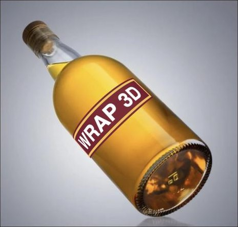

_The **WRAP 3D** label wrapped around a bottle in a photo._

How does it work? Inside the plugin there is an invisible 3D shape: a cylinder, a ball, a cone or a bottle of any shape. You put it on the object in the photo, and the plugin stretches the label over it and puts the result into Photoshop as a new layer. The shape itself, the grid and the markers never get into the document — only the label does.

## Meet the panel

Open the panel from the **Plugins ▸ Pixel Wrap 3D** menu in Photoshop. You can keep it docked or pull it out as a separate window — then it is wider and everything is easier to see.

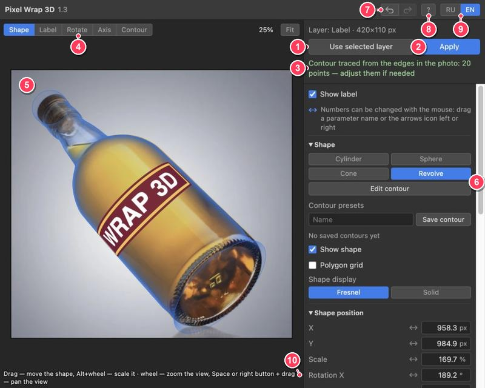

_The plugin panel. The numbers are explained in the list below the picture._

1. **Use selected layer** takes the layer selected in Photoshop into the plugin.
2. **Apply** puts the finished label into the document.
3. The status line. The plugin tells you here what it did and what to do next. Green text means it worked, red means something is wrong — and says what.
4. Modes — two labelled groups of buttons. **Mouse:** — what the mouse does in the view: move the shape, move the label or turn the shape. **From photo:** — fitting the shape to the photo: **Axis** and, for a body of revolution, **Contour**.
5. The view: your photo with the shape and the label on it. The mouse wheel zooms in and out, **Fit** shows the whole document.
6. Settings: numbers, check boxes and buttons. The column scrolls, and each group folds with the triangle next to its name.
7. The arrows undo and redo.
8. **?** opens this help.
9. RU / EN — the panel language.
10. A hint: what the mouse and keys do right now.

## Quick start: six steps

1. In Photoshop, select the layer with your text or logo and click **Use selected layer**.
2. Pick a shape like your object: a can — **Cylinder**, a ball — **Sphere**, a cup — **Cone**, a bottle with shoulders and a neck — **Revolve**.
3. In the **Shape** group click **Fit by axis**, put the markers on the object and click **Refine from photo**.
4. If you need to, turn the shape in the **Rotate** mode.
5. In the **Label** mode move the label to where it belongs.
6. Click **Apply**, and a new layer with the label appears in the document.

The plugin itself tells you what to do next in the status line after each step. Each step is explained below, with pictures. Next time you open the panel, it remembers how things were the last time you clicked **Apply**.

## Step 1. Take the label

The label is an ordinary Photoshop layer: text, a logo, a smart object or a picture on a transparent background. It can be any colour.

1. Open the photo you want to put the label on. The document must be in RGB mode.
2. Put the label into this document as a separate layer.
3. Select this layer in the **Layers** panel — exactly one.
4. Click **Use selected layer** (1).

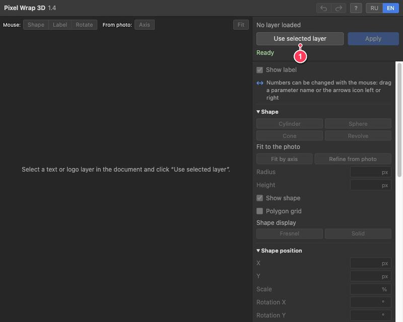

_Until a layer is taken, the view is empty. Click button (1)._

The plugin remembers how the document looks — that is the backdrop in the view — and takes the label. The layer itself does not change in Photoshop. If you change something in the document later, click **Refresh backdrop**.

## Step 2. Pick a shape

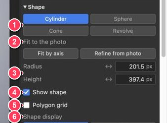

_The **Shape** group. The numbers are explained below._

- **(1) Which shape** — **Cylinder** — like a can or a straight bottle. **Sphere** — like a ball or a Christmas bauble. **Cone** — like a cup: narrower at one end, wider at the other. **Revolve** — any round shape whose contour you draw yourself: a bottle with shoulders, a vase, a flask.
- (2) **Fit to the photo** — The buttons that put the shape on the object: **Fit by axis** turns on the **Axis** mode, **Refine from photo** pulls the shape to the edges in the photo, and a body of revolution also has **Trace from photo**. Each one turns on the mode it needs. A sphere has none of these: it has no axis.
- **(3) Size** — **Radius** and **Height** are how thick and how long the shape is; a cone has **Top radius** and **Bottom radius**. Usually the **Axis** mode sets them, so you don't need to touch them.
- (4) **Show shape** — Show or hide the shape. The label is visible either way.
- (5) **Polygon grid** — A grid on the shape, like on a globe. It shows clearly how the shape is turned. It works with a hidden shape too and never gets into the result.
- (6) **Shape display** — **Fresnel** — a see-through shape with bright edges. **Solid** — a solid one; how solid is set with the **Opacity** slider.

## Step 3. Put the shape on the object: the Axis mode

This is the most important step. You show the plugin where the object's axis is — an imaginary stick through its middle, like a skewer through a kebab — and where its edges are. The plugin works out everything else by itself: where the shape stands, how big it is, how it is turned and how strong the perspective in the photo is.

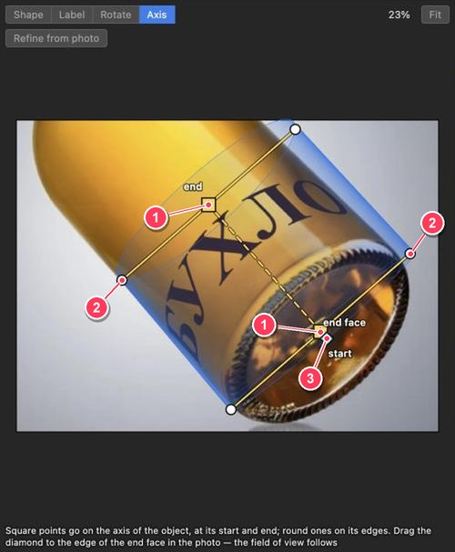

_The markers are placed roughly — that is fine to start with. (1) — the ends of the axis, (2) — the edges, (3) — the diamond._

1. Click **Fit by axis** in the **Shape** group — or **Axis** at the top, in the **From photo** group. Markers appear on the shape.
2. The square markers (1) are the ends of the axis. Put one at the start of the object (the bottom of a bottle) and the other at its end.
3. The round markers (2) are the edges. Move them to the edges of the object at each end.
4. The diamond (3) is the edge of the end face — the bottom or the lid — that you can see in the photo. Drag it to that edge in the photo, and **Field of view** is set by itself.

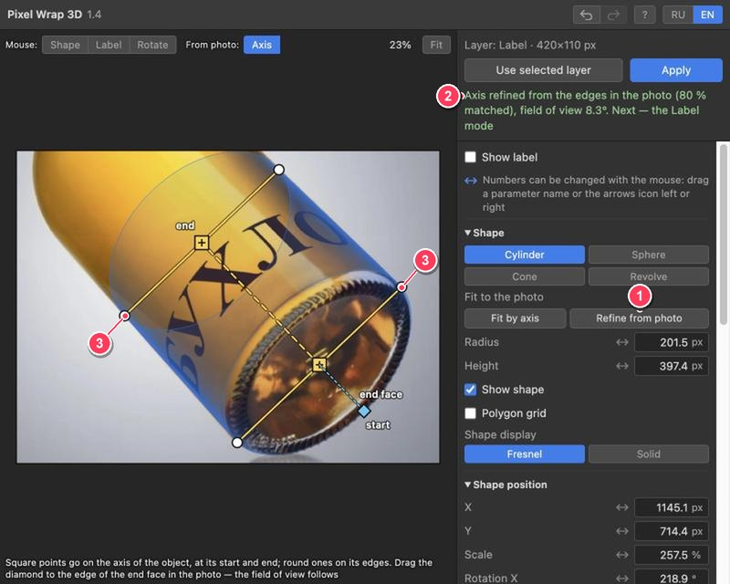

_After **Refine from photo** (1) the markers sit exactly on the edges of the bottle (3), and the status line (2) tells you what happened._

You don't have to place the markers exactly. Place them roughly and click **Refine from photo** (1) in the **Shape** group: the plugin finds the edges of the object in the photo and moves the markers. If it finds the edge of the bottom, it sets **Field of view** too. The bottom may face you or face away, and its edge is in the same place in the photo either way; the plugin tells which by whether the far half of its rim shows. Don't like the result? Press Cmd+Z.

It works best when the object stands out from the background. Clear glass and dark on dark are found less reliably. If no edges are found, or they are too far away, the axis stays as it was.

A few more rules. The shape turns its front to you: **Rotation Y** becomes 0. You can change **Field of view** and the radius by hand too — the markers stay where they are. If the lines between the markers turn red, no shape can be built from those points, and it stays as it was. If the diamond turns red, the field of view could not be found — for example, the bottom is seen almost edge-on.

This mode does not work for a sphere — a ball has no ends — nor for a contour that closes to a point at an end. For a body of revolution **Refine from photo** looks for edges next to the contour you already have: it pulls the axis and the contour points to them and leaves the width at the ends and the field of view alone — the markers set those. An orthographic camera has no diamond: there is no perspective there, and the length of the shape is kept.

## Step 4. Turn the shape: the Rotate mode

Usually you don't need to turn anything after the **Axis** mode — the shape already stands right. But if you want to turn it yourself, here is how.

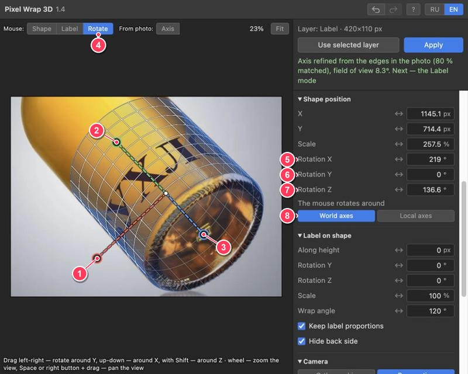

_While you turn the shape, its axes show in its middle: (1) X is red, (2) Y is green and runs along the shape, (3) Z is blue._

Click **Rotate** (4) and drag in the view: left-right turns the shape around the Y axis, up-down around the X axis, with Shift around the Z axis, which looks straight at you. A dashed axis points away from you, a solid one towards you.

- (5) **Rotation X** — Turns around the horizontal axis: the top of the shape towards you or away.
- (6) **Rotation Y** — Turns around the vertical axis: the shape shows you one end, then the other.
- (7) **Rotation Z** — Turns around the line of sight — like a clock hand.
- (8) **The mouse rotates around** — Whose axes the mouse turns around: **World axes** — the scene's, like in a 3D program, **Local axes** — the shape's own.
- **X** and **Y** — Where the centre of the shape is, in document pixels.
- **Scale** — The size of the whole shape.

Angles work like in 3D programs: a full circle from 0 to 360°, and after 360 comes 0 again. The shape turns around X first, then around Y, then around Z — all three about the scene's axes.

## Step 5. Place the label: the Label mode

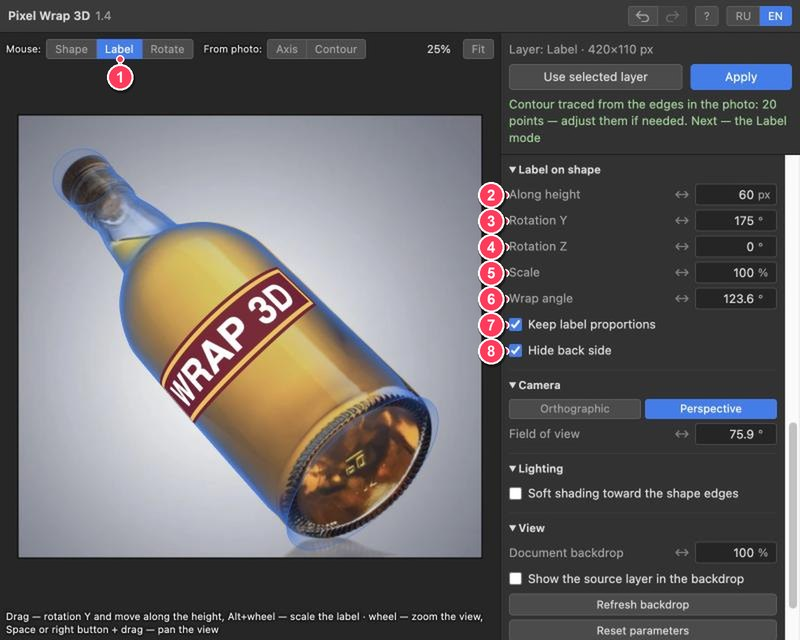

_The **Label** mode (1) and the label fields (2–8)._

Click **Label** (1) and drag the label right in the view: left-right moves it around the shape, up-down along it. Alt + mouse wheel makes it bigger or smaller.

- (2) **Along height** — Higher or lower on the shape.
- (3) **Rotation Y** — Around the shape — the label goes round in a circle.
- (4) **Rotation Z** — Turns the label itself on the surface: 90° — on its side, 180° — upside down.
- (5) **Scale** — The size of the label.
- (6) **Wrap angle** — How much of the circle the label covers: 360° is the whole way round.
- (7) **Keep label proportions** — The label does not stretch: size and wrap angle change together.
- (8) **Hide back side** — The part of the label that went behind the shape is hidden — like on a real label.

The **Show label** check box at the very top of the settings hides the label while you place the shape. It does not affect the result.

## Step 6. Done: Apply

Click **Apply**. The plugin asks how to insert the label and remembers your choice.

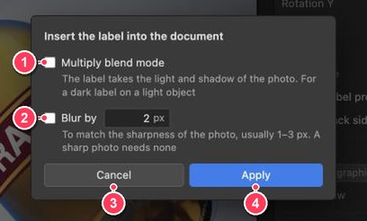

_The question before inserting._

- (1) **Multiply blend mode** — The label takes the light and shadow of the photo and stops looking like a sticker. Best for a dark label on a light object.
- (2) **Blur by** — Blurs the label a little if the photo is not very sharp: usually by 1–3 px. A sharp photo needs none.
- (3) **Cancel** — Changed your mind — insert nothing.
- (4) **Apply** — Insert.

A new layer appears in the document: the label exactly in its place, on a transparent background. It is one step in Photoshop's history. The source layer does not change. The result area is up to 64 megapixels.

## A bottle with shoulders: Revolve and the contour

Many bottles have shoulders and a neck, and a cylinder won't fit them. For such objects there is the **Revolve** shape: you set its contour — the silhouette — and the plugin spins it around the axis, like a potter making a vase on a wheel.

1. First pick the cylinder, set it along the body of the bottle in the **Axis** mode and click **Refine from photo**.
2. Switch the shape to **Revolve** — the **Contour** mode opens. The **Edit contour** button opens it too.
3. Click **Trace from photo** in the **Shape** group, and the plugin traces the bottle for you.
4. If something doesn't match, fix the points with the mouse.

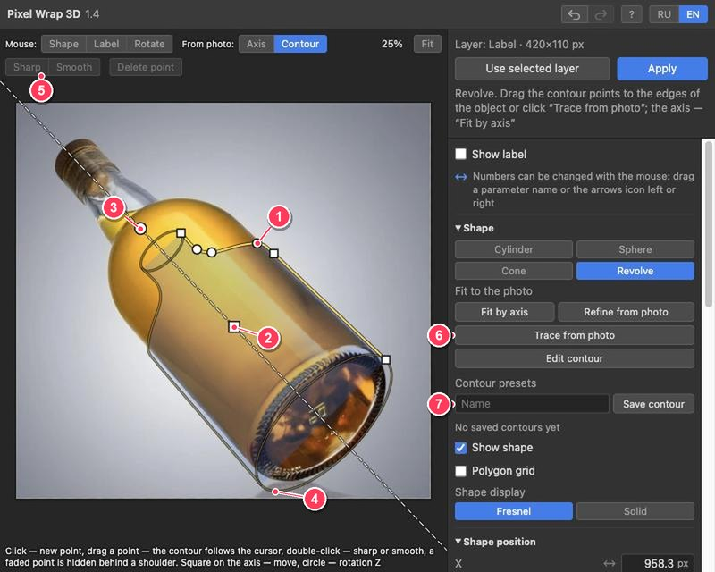

_Right after switching, the contour doesn't match the bottle yet. The numbers are explained below._

- **(1) A contour point** — Drag it, and the contour line passes under the cursor. A double click makes the point sharp or smooth. A click on an empty spot adds a new point that you can drag straight away.
- **(2) The square on the axis** — Moves the axis together with the shape.
- **(3) The circle at the end of the axis** — Turns the shape around the Z axis.
- **(4) The thin ellipse** — The rim at the end of the shape. It shows how the shape is turned towards you.
- (5) **Sharp**, **Smooth**, **Delete point** — What to do with the selected point. The Delete key removes it too.
- (6) **Trace from photo** — Trace the bottle from the photo. The button is in the **Shape** group, next to **Refine from photo**.
- (7) **Contour presets** — Keep a good contour: type a name and click **Save contour**.

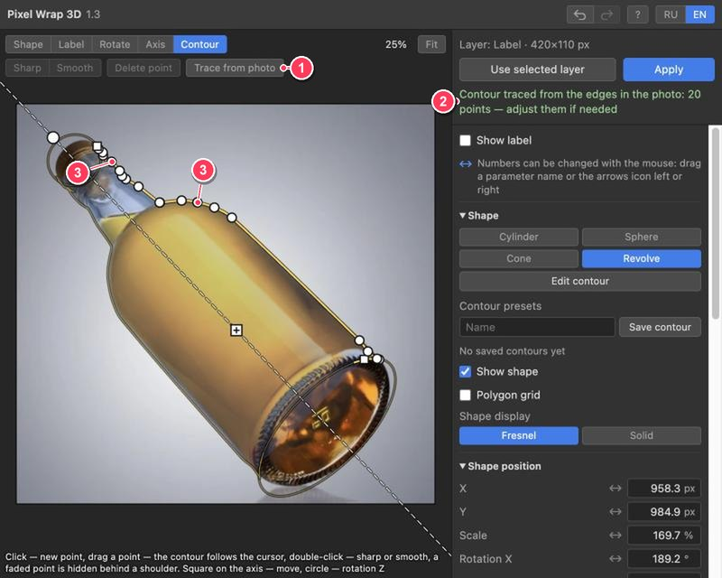

_After **Trace from photo** (1) the contour runs along the edges of the bottle (3), and the status line (2) tells you how many points it made._

**Trace from photo** goes along the axis from the bottom up and looks for the edges of the bottle on both sides, tilt and perspective included, as far out as the widest part of the contour you already have. The axis and the bottom of the shape stay as they were. It works best when the bottle stands out from the background; clear glass and a cork are found less reliably. If no edges are found, or only near the bottom, the contour stays as it was. Undo with Cmd+Z.

If the body is nothing like a cylinder — a bulb, a vase — put the axis markers on the body of revolution straight away, draw the contour roughly and click **Refine from photo** in the **Shape** group: the plugin pulls both the axis and the contour points to the edges in the photo. You keep as many points as you had.

Why does a point sometimes move somewhere other than the cursor? The shoulders of a tilted bottle look different in the photo from the profile in section, and the plugin moves the point so that the contour line is what passes under the cursor. A faded point is hidden: with a strong tilt a steep shoulder at that height faces you and makes no edge. Such a point moves the way it would on a cylinder. Parts of the shape covered by other parts (a neck behind a shoulder) are still drawn.

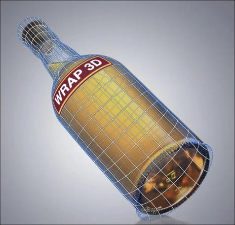

_Done: the label on the shoulder of the bottle bends with it._

## Mouse modes in short

The buttons above the view come in two labelled groups. **Mouse:** — what the mouse does: **Shape**, **Label**, **Rotate**. **From photo:** — fitting the shape to the photo: **Axis** and **Contour**.

- **Shape** — Drag to move the shape around the document. Alt + wheel — the size of the shape.
- **Label** — Drag left-right — the label moves around the shape (**Rotation Y**), up-down — along it. Alt + wheel — the size of the label.
- **Rotate** — Drag to turn the shape. More in step 4.
- **Axis** — Put the shape on the object with markers — step 3.
- **Contour** — Draw the contour. The button is there only for a body of revolution.

In any mode: the wheel zooms the view, Space or the right button + drag pans it, **Fit** shows the whole document. Alt + drag switches to **Label** for a moment, Shift + drag to **Rotate**.

## Camera, light and view

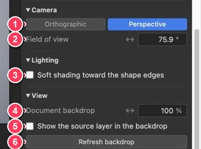

_The **Camera**, **Lighting** and **View** groups._

- (1) **Perspective** and **Orthographic** — Perspective is like a real photo: near things are bigger than far ones. Orthographic has no perspective — for objects shot from far away.
- (2) **Field of view** — How strong the perspective is: the bigger the angle, the stronger. Usually the **Axis** mode sets it.
- (3) **Soft shading toward the shape edges** — The label gets darker towards the edges of the shape, like in real life. How much is set by **Shading strength**. Off by default: the label colours stay as they are.
- (4) **Document backdrop** — How much of the photo shows under the shape in the view.
- (5) **Show the source layer in the backdrop** — Shows the original flat layer in the backdrop. It usually gets in the way, so it is off.
- (6) **Refresh backdrop** — Reads the document again if you changed it in Photoshop.
- **Reset parameters** — Puts the shape and the label back to the start.
- **Last applied parameters** — Brings back everything as it was the last time you clicked **Apply**.

## How to change numbers

- Type a number and press Enter.
- The up and down arrow keys change the number by one step, with Shift ten times faster.
- Drag the field name or the arrows icon left or right. With Shift it goes faster, with Alt more precisely.

## Undo and redo

- Cmd+Z (Ctrl+Z on Windows) goes one step back, Shift+Cmd+Z or Ctrl+Y one step forward. The two arrows in the panel header do the same.
- One step is one finished action: a drag, a typed number, a change of shape.
- **Apply** is a step in Photoshop's own history. To remove an inserted label, click the document and press Cmd+Z there.

## To make the label look real

- Insert a dark label on a light object with **Multiply blend mode**.
- If the photo is softer than the label, turn on **Blur by**.
- If the edges of the object get noticeably darker, turn on **Soft shading toward the shape edges**.
- A highlight over the print is made in Photoshop itself: **Blending Options ▸ Blend If** — let the lightest tones of the layer below show through.

## Glossary

- **Axis** — An imaginary line through the middle of a round object, which it spins around: for a bottle, from the bottom to the neck.
- **End face** — A flat end of the shape: the bottom or the lid.
- **Contour** — The silhouette of half of the object, as if you cut it along the axis. The plugin spins the contour around the axis and gets the shape.
- **Perspective** — Near things look bigger, far things smaller. Every camera shoots like that.
- **Field of view** — How strong the perspective in the photo is. A wide angle is like a phone right next to the object, a narrow one like a zoom from far away.
- **Marker** — A point you can drag with the mouse.
- **Layer** — A separate sheet in a Photoshop document. The label is on its own layer, and the plugin puts the result on a new layer too.
- **Multiply blend mode** — A way of blending: dark darkens the photo and white disappears. That is why the label takes the light and shadow of the photo.

## If something goes wrong

- **The panel is not in the menu** — Installed from the .ccx file: restart Photoshop and check in the Creative Cloud app (**Stock & Marketplace ▸ Plugins ▸ Manage plugins**) that Pixel Wrap 3D is there and not disabled. Loaded through UXP Developer Tools: start Photoshop first, then press **Load**; after Photoshop restarts the plugin has to be loaded again.
- **The header shows the wrong version** — The .ccx file: double-click the new .ccx — it replaces the old version — and restart Photoshop. UXP Developer Tools: use **Unload** and **Load**, because after **Reload** Photoshop keeps the old manifest.
- **“No layer selected”, “Several layers are selected — select just one”** — Select exactly one layer in the **Layers** panel and click **Use selected layer**.
- **The document is not RGB** — The plugin works with RGB only: **Image ▸ Mode ▸ RGB Color**.
- **Another document is active** — Go back to the document the layer came from, or take the layer again.
- **The label disappeared** — It went to the back of the shape. Clear **Hide back side** or move it: **Rotation Y** in the **Label on shape** group by 180°.
- **Cmd+Z does nothing** — Use the arrows in the panel header: Photoshop may catch the shortcut before the plugin does.
- **“The label is outside the document bounds”** — The shape is outside the document, or the whole label is on the back side.

Questions and bugs: pixmap1981@gmail.com or the Issues page at github.com/Toys-D/PixelWrap3D. Write the version from the panel header and what you did, and attach a screenshot. If the plugin is loaded through UXP Developer Tools, also attach the lines from its console that start with [Wrap3D].
