# Справка по Pixel Wrap 3D

In English: [HELP.md](HELP.md)

## Что это за плагин

Представь: у тебя есть фото бутылки и картинка-этикетка. Если просто положить картинку на фото, она останется плоской, как наклейка на экране. Pixel Wrap 3D оборачивает её вокруг бутылки, как настоящую этикетку: она изгибается, уходит за край и становится меньше там, где бутылка дальше от тебя.

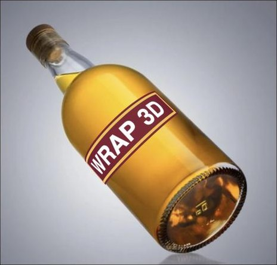

_Надпись «WRAP 3D» обёрнута вокруг бутылки на фото._

Как это получается? Внутри плагина есть невидимая 3D-форма: цилиндр, шар, конус или бутылка любой формы. Ты ставишь её на предмет на фото, а плагин натягивает на неё надпись и кладёт результат в Photoshop новым слоем. Сама форма, сетка и маркеры в документ не попадают — только надпись.

## Знакомимся с панелью

Панель открывается в Photoshop через меню «Плагины ▸ Pixel Wrap 3D». Её можно оставить в доке или вытащить отдельным окном — так она шире, и всё видно лучше.

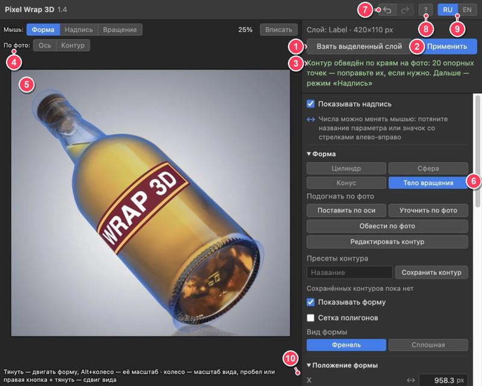

_Панель плагина. Что значат номера — в списке под картинкой._

1. «Взять выделенный слой» — забирает в плагин слой, выделенный в Photoshop.
2. «Применить» — кладёт готовую надпись в документ.
3. Строка состояния. Здесь плагин пишет, что он сделал и что делать дальше. Зелёный текст — всё получилось, красный — что-то не так, и там же написано что.
4. Режимы — две подписанные группы кнопок. «Мышь:» — что делает мышь в окне просмотра: двигает форму, двигает надпись или вращает форму. «По фото:» — подгонка формы по фото: «Ось» и, у тела вращения, «Контур».
5. Окно просмотра: твоё фото, а на нём форма и надпись. Колесо мыши приближает и отдаляет, «Вписать» показывает документ целиком.
6. Настройки: числа, флажки и кнопки. Колонку можно прокручивать, а группы — сворачивать треугольником у названия.
7. Стрелки — отменить действие и вернуть его.
8. «?» — эта справка.
9. RU / EN — язык панели.
10. Подсказка: что сейчас делают мышь и клавиши.

## Быстрый старт: шесть шагов

1. В Photoshop выдели слой с надписью или логотипом и нажми «Взять выделенный слой».
2. Выбери форму, похожую на предмет: банка — «Цилиндр», мяч — «Сфера», стаканчик — «Конус», бутылка с плечами и горлышком — «Тело вращения».
3. В группе «Форма» нажми «Поставить по оси», поставь маркеры на предмет и нажми «Уточнить по фото».
4. Если нужно, поверни форму в режиме «Вращение».
5. В режиме «Надпись» передвинь надпись туда, где она должна быть.
6. Нажми «Применить» — в документе появится новый слой с надписью.

Что делать дальше, плагин и сам подсказывает в строке состояния после каждого шага. Ниже каждый шаг разобран подробно, с картинками. Когда ты откроешь панель в следующий раз, она сама вспомнит, что было при последнем нажатии «Применить».

## Шаг 1. Возьми надпись

Надпись — это обычный слой Photoshop: текст, логотип, смарт-объект или картинка на прозрачном фоне. Цвета у неё могут быть любые.

1. Открой фото, на которое хочешь нанести надпись. Документ должен быть в режиме RGB.
2. Положи надпись в этот документ отдельным слоем.
3. Выдели этот слой в панели «Слои» — ровно один.
4. Нажми «Взять выделенный слой» (1).

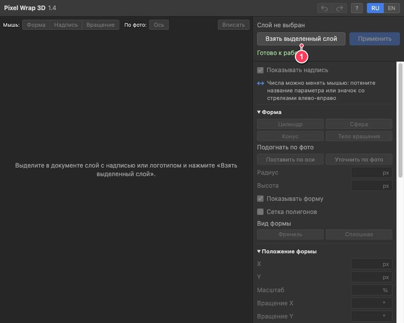

_Пока слой не взят, окно просмотра пустое. Нажми кнопку (1)._

Плагин запомнит, как выглядит документ, — это фон в окне просмотра, — и возьмёт надпись. Сам слой в Photoshop не меняется. Если потом поменяешь что-то в документе, нажми «Обновить фон».

## Шаг 2. Выбери форму

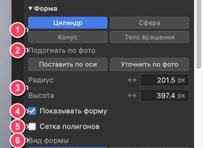

_Группа «Форма». Номера — в списке ниже._

- **(1) Какая форма** — «Цилиндр» — как банка или прямая бутылка. «Сфера» — как мяч или ёлочный шар. «Конус» — как стаканчик: с одного конца уже, с другого шире. «Тело вращения» — любая круглая форма, контур которой ты рисуешь сам: бутылка с плечами, ваза, флакон.
- **(2) «Подогнать по фото»** — Кнопки, которые ставят форму на предмет: «Поставить по оси» включает режим «Ось», «Уточнить по фото» подтягивает форму к краям на фото, у тела вращения есть ещё «Обвести по фото». Каждая сама включает нужный режим. У шара этих кнопок нет: у него нет оси.
- **(3) Размеры** — «Радиус» и «Высота» — толщина и длина формы, у конуса — «Радиус сверху» и «Радиус снизу». Обычно их подбирает режим «Ось», так что трогать руками не нужно.
- **(4) «Показывать форму»** — Показать или спрятать форму. Надпись видна в любом случае.
- **(5) «Сетка полигонов»** — Сетка на форме, как на глобусе. По ней хорошо видно, как форма повёрнута. Работает и со спрятанной формой, в результат не попадает.
- **(6) «Вид формы»** — «Френель» — прозрачная форма с яркими краями. «Сплошная» — сплошная, а насколько плотная — задаёт ползунок «Непрозрачность».

## Шаг 3. Поставь форму на предмет: режим «Ось»

Это самый главный шаг. Ты показываешь плагину, где у предмета ось — воображаемая палочка через его середину, как шампур через шашлык, — и где у него края. Всё остальное плагин посчитает сам: где стоит форма, какого она размера, как повёрнута и насколько сильная на фото перспектива.

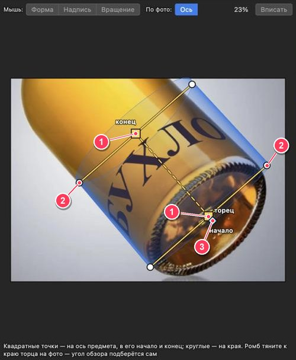

_Маркеры поставлены примерно — для начала так и надо. (1) — концы оси, (2) — края, (3) — ромб._

1. Нажми «Поставить по оси» в группе «Форма» — или «Ось» вверху, в группе «По фото». На форме появятся маркеры.
2. Квадратные маркеры (1) — концы оси. Поставь один в начало предмета (у бутылки — донышко), другой — в конец.
3. Круглые маркеры (2) — края. Подвинь их к краям предмета на каждом конце.
4. Ромб (3) — край торца, то есть донышка или крышки, который виден на фото. Потяни его к этому краю на фото — «Угол обзора» подберётся сам.

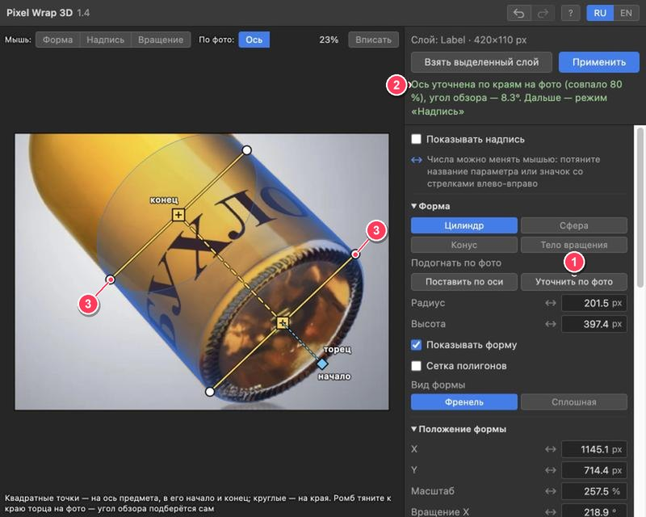

_После «Уточнить по фото» (1) маркеры встали точно на края бутылки (3), а строка состояния (2) рассказала, что получилось._

Ставить маркеры точно не обязательно. Поставь примерно и нажми «Уточнить по фото» (1) в группе «Форма»: плагин сам найдёт края предмета на фото и передвинет маркеры. Если найдёт край донышка — подберёт и «Угол обзора». Донышко может смотреть на тебя или от тебя, а его край на фото в обоих случаях на одном месте; плагин понимает, как на самом деле, по тому, видна ли дальняя половина ободка. Не понравилось — нажми Cmd+Z.

Лучше всего это работает, когда предмет хорошо отличается от фона. Прозрачное стекло и тёмное на тёмном находятся хуже. Если края не нашлись или нашлись слишком далеко, ось не меняется.

Ещё несколько правил. Форма встаёт передом к тебе: «Вращение Y» становится 0. «Угол обзора» и радиус можно менять и руками — маркеры останутся на месте. Если линии между маркерами покраснели, по таким точкам форму не построить, и она остаётся прежней. Если покраснел ромб, угол обзора подобрать не вышло — например, донышко видно совсем ребром.

Для шара этот режим не работает — у шара нет концов, — и для контура, который на конце сходится в точку, тоже. У тела вращения «Уточнить по фото» ищет края рядом с контуром, который уже стоит: подтягивает к ним ось и точки контура, а ширину на концах и угол обзора не трогает — их задают маркеры. В ортогональной камере ромба нет: там нет перспективы, и длина формы сохраняется.

## Шаг 4. Поверни форму: режим «Вращение»

Обычно после режима «Ось» поворачивать ничего не нужно — форма уже стоит как надо. Но если хочешь повернуть её сам, вот как.

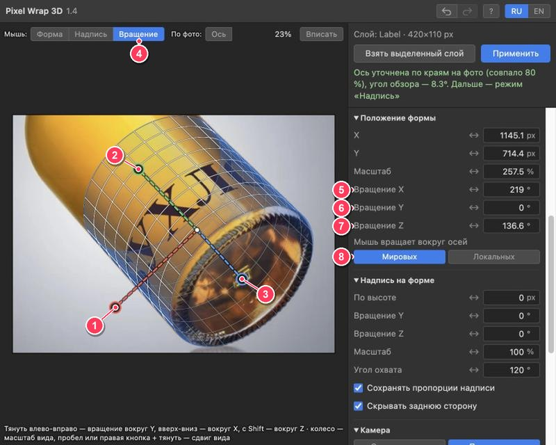

_Пока крутишь форму, в её центре видны оси: (1) X — красная, (2) Y — зелёная, вдоль формы, (3) Z — синяя._

Нажми «Вращение» (4) и тяни мышью в окне просмотра: влево-вправо — форма крутится вокруг оси Y, вверх-вниз — вокруг оси X, с Shift — вокруг оси Z, которая смотрит прямо на тебя. Пунктирная ось уходит от тебя, сплошная — к тебе.

- **(5) «Вращение X»** — Поворот вокруг горизонтальной оси: верх формы к тебе или от тебя.
- **(6) «Вращение Y»** — Поворот вокруг вертикальной оси: форма поворачивается к тебе то одним, то другим концом.
- **(7) «Вращение Z»** — Поворот вокруг оси взгляда — как стрелка часов.
- **(8) «Мышь вращает вокруг осей»** — Вокруг чьих осей крутит мышь: «Мировых» — сцены, как в 3D-программе, «Локальных» — самой формы.
- **«X» и «Y»** — Где центр формы, в пикселях документа.
- **«Масштаб»** — Размер формы целиком.

Углы — как в 3D-программах: целый круг от 0 до 360°, после 360 снова идёт 0. Форма поворачивается сначала вокруг X, потом вокруг Y, потом вокруг Z — все три по осям сцены.

## Шаг 5. Поставь надпись: режим «Надпись»

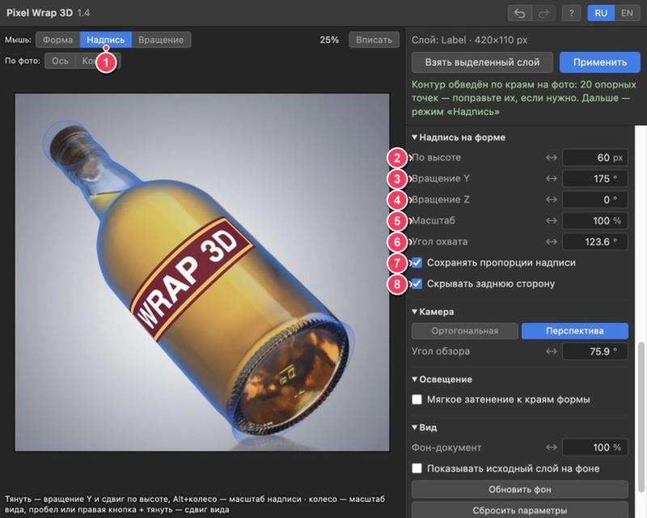

_Режим «Надпись» (1) и поля надписи (2–8)._

Нажми «Надпись» (1) и тяни надпись прямо в окне просмотра: влево-вправо — она едет вокруг формы, вверх-вниз — вдоль неё. Alt + колесо мыши — больше или меньше.

- **(2) «По высоте»** — Выше или ниже по форме.
- **(3) «Вращение Y»** — Вокруг формы — надпись едет по кругу.
- **(4) «Вращение Z»** — Поворот самой надписи на поверхности: 90° — набок, 180° — вверх ногами.
- **(5) «Масштаб»** — Размер надписи.
- **(6) «Угол охвата»** — Какую часть круга занимает надпись: 360° — вся окружность.
- **(7) «Сохранять пропорции надписи»** — Надпись не растягивается: размер и угол охвата меняются вместе.
- **(8) «Скрывать заднюю сторону»** — Часть надписи, которая ушла за форму, не видна — как у настоящей этикетки.

Флажок «Показывать надпись» в самом верху настроек прячет надпись, пока ты ставишь форму. На результат он не влияет.

## Шаг 6. Готово: «Применить»

Нажми «Применить». Плагин спросит, как вставить надпись, и запомнит твой выбор.

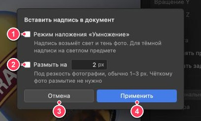

_Вопрос перед вставкой._

- **(1) «Режим наложения «Умножение»»** — Надпись возьмёт свет и тени фото и перестанет выглядеть наклейкой. Лучше всего для тёмной надписи на светлом предмете.
- **(2) «Размыть на»** — Чуть размыть надпись, если фото не очень резкое: обычно на 1–3 px. Чёткому фото не нужно.
- **(3) «Отмена»** — Передумал — ничего не вставлять.
- **(4) «Применить»** — Вставить.

В документе появится новый слой: надпись точно на своём месте, на прозрачном фоне. В истории Photoshop это одна запись. Исходный слой не меняется. Область результата — до 64 мегапикселей.

## Бутылка с плечами: тело вращения и контур

У многих бутылок есть плечи и горлышко, и цилиндр на них не ляжет. Для таких предметов есть форма «Тело вращения»: ты задаёшь её контур — силуэт, — а плагин вращает его вокруг оси, как гончар лепит вазу на круге.

1. Сначала выбери цилиндр, поставь его по корпусу бутылки в режиме «Ось» и нажми «Уточнить по фото».
2. Переключи форму на «Тело вращения» — откроется режим «Контур». Его можно открыть и кнопкой «Редактировать контур».
3. Нажми «Обвести по фото» в группе «Форма» — плагин сам обведёт бутылку.
4. Если где-то не совпало, поправь точки мышью.

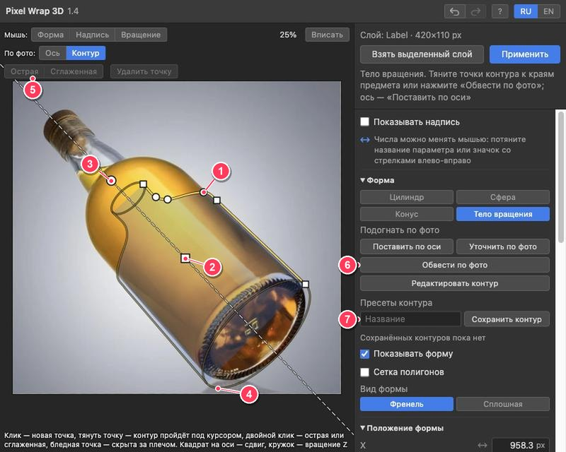

_Сразу после переключения контур ещё не совпадает с бутылкой. Номера — в списке ниже._

- **(1) Точка контура** — Тяни её — линия контура пройдёт под курсором. Двойной клик делает точку острой или сглаженной. Клик по пустому месту ставит новую точку, и её сразу можно тянуть.
- **(2) Квадрат на оси** — Сдвигает ось вместе с формой.
- **(3) Кружок на конце оси** — Поворачивает форму вокруг оси Z.
- **(4) Тонкий эллипс** — Ободок на конце формы. По нему видно, как форма повёрнута к тебе.
- **(5) «Острая», «Сглаженная», «Удалить точку»** — Что сделать с выбранной точкой. Клавиша Delete тоже её удаляет.
- **(6) «Обвести по фото»** — Обвести бутылку по фото. Кнопка — в группе «Форма», рядом с «Уточнить по фото».
- **(7) «Пресеты контура»** — Удачный контур можно сохранить: впиши название и нажми «Сохранить контур».

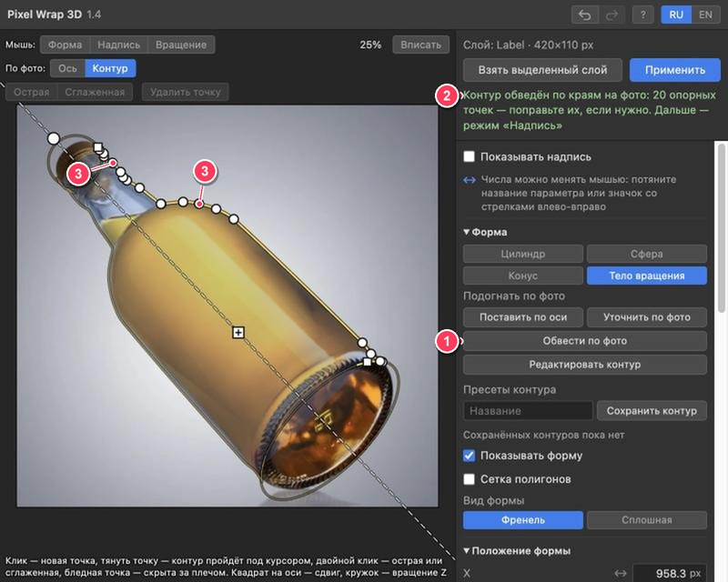

_После «Обвести по фото» (1) контур прошёл по краям бутылки (3), а строка состояния (2) рассказала, сколько точек получилось._

«Обвести по фото» идёт вдоль оси от донышка вверх и ищет края бутылки с обеих сторон, с учётом наклона и перспективы, — до самой широкой части контура, который уже стоит. Ось и низ формы не меняются. Лучше всего — когда бутылка хорошо отличается от фона; прозрачное стекло и пробка находятся хуже. Если края не нашлись или нашлись только у низа, контур не меняется. Отменить — Cmd+Z.

Если корпус не похож на цилиндр — колба, ваза, — поставь маркеры оси сразу у тела вращения, нарисуй контур примерно и нажми «Уточнить по фото» в группе «Форма»: плагин подтянет к краям на фото и ось, и точки контура. Сколько точек было, столько и останется.

Почему точка иногда едет не туда, куда курсор? Плечи наклонённой бутылки на фото выглядят не так, как в разрезе, и плагин двигает точку так, чтобы под курсором прошла именно линия контура. Бледная точка — скрытая: при сильном наклоне крутое плечо на этой высоте смотрит прямо на тебя и края не даёт. Такая точка двигается так, как у цилиндра. Части формы, закрытые другими её частями (горлышко за плечом), контур всё равно рисует.

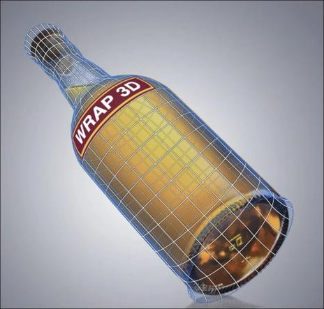

_Готово: надпись на плече бутылки изгибается вместе с ним._

## Режимы мыши — коротко

Кнопки над окном просмотра разбиты на две подписанные группы. «Мышь:» — что делает мышь: «Форма», «Надпись», «Вращение». «По фото:» — подгонка формы по фото: «Ось» и «Контур».

- **«Форма»** — Тяни — форма едет по документу. Alt + колесо — размер формы.
- **«Надпись»** — Тяни влево-вправо — надпись едет вокруг формы («Вращение Y»), вверх-вниз — вдоль неё. Alt + колесо — размер надписи.
- **«Вращение»** — Тяни — форма вращается. Подробно — в шаге 4.
- **«Ось»** — Ставишь форму по маркерам — шаг 3.
- **«Контур»** — Рисуешь контур. Кнопка есть только у тела вращения.

В любом режиме: колесо — приблизить или отдалить вид, пробел или правая кнопка + тянуть — сдвинуть вид, «Вписать» — показать документ целиком. Alt + тянуть на время включает «Надпись», Shift + тянуть — «Вращение».

## Камера, свет и вид

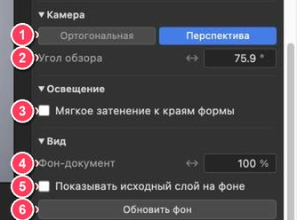

_Группы «Камера», «Освещение» и «Вид»._

- **(1) «Перспектива» и «Ортогональная»** — Перспектива — как на настоящем фото: ближнее больше дальнего. Ортогональная — без перспективы, для предметов, снятых издалека.
- **(2) «Угол обзора»** — Насколько сильная перспектива: чем больше угол, тем она сильнее. Обычно его подбирает режим «Ось».
- **(3) «Мягкое затенение к краям формы»** — Надпись темнеет к краям формы, как в жизни. Насколько — задаёт «Сила затенения». По умолчанию выключено: цвета надписи не меняются.
- **(4) «Фон-документ»** — Насколько видно фото под формой в окне просмотра.
- **(5) «Показывать исходный слой на фоне»** — Показать на фоне исходный плоский слой. Обычно он мешает, поэтому выключен.
- **(6) «Обновить фон»** — Перечитать документ, если ты поменял его в Photoshop.
- **«Сбросить параметры»** — Вернуть форму и надпись к началу.
- **«Параметры последнего применения»** — Вернуть всё, как было при последнем нажатии «Применить».

## Как менять числа

- Впиши число и нажми Enter.
- Стрелки вверх и вниз на клавиатуре меняют число на шаг, с Shift — в десять раз быстрее.
- Потяни мышью название поля или значок со стрелками влево-вправо. С Shift — быстрее, с Alt — точнее.

## Отмена и повтор

- Cmd+Z (на Windows — Ctrl+Z) — шаг назад, Shift+Cmd+Z или Ctrl+Y — шаг вперёд. То же делают две стрелки в шапке панели.
- Один шаг — одно законченное действие: перетащил, ввёл число, сменил форму.
- «Применить» — это запись в истории самого Photoshop. Чтобы убрать вставленную надпись, щёлкни по документу и нажми Cmd+Z там.

## Чтобы надпись выглядела настоящей

- Тёмную надпись на светлом предмете вставляй с «Режим наложения «Умножение»».
- Если фото мягче надписи, включи «Размыть на».
- Если у предмета заметно темнеют края, включи «Мягкое затенение к краям формы».
- Блик поверх краски делается уже в Photoshop: «Параметры наложения ▸ Наложить, если» — пропусти самые светлые тона нижнего слоя.

## Словарик

- **Ось** — Воображаемая линия через середину круглого предмета, вокруг которой он «крутится»: у бутылки — от донышка к горлышку.
- **Торец** — Плоский конец формы: донышко или крышка.
- **Контур** — Силуэт половины предмета, если разрезать его вдоль оси. Плагин вращает контур вокруг оси и получает форму.
- **Перспектива** — Ближнее кажется больше, дальнее — меньше. Так снимает любой фотоаппарат.
- **Угол обзора** — Насколько сильная перспектива на фото. Широкий угол — как телефон вплотную к предмету, узкий — как зум издалека.
- **Маркер** — Точка, которую можно тянуть мышью.
- **Слой** — Отдельный лист в документе Photoshop. Надпись лежит на своём слое, и плагин кладёт результат тоже на новый слой.
- **«Режим наложения «Умножение»»** — Способ наложения: тёмное затемняет фото, а белое пропадает. Поэтому надпись берёт свет и тени фото.

## Если что-то не получается

- **Плагин не загружается** — Сначала запусти Photoshop, потом в UXP Developer Tools нажми **Load**. После перезапуска Photoshop плагин нужно загружать заново.
- **В шапке не та версия** — Сделай **Unload** и **Load**: после **Reload** Photoshop помнит старый манифест.
- **«Не выделен ни один слой», «Выделено несколько слоёв — оставьте один»** — Выдели в панели «Слои» ровно один слой и нажми «Взять выделенный слой».
- **Документ не RGB** — Плагин работает только с RGB: «Изображение ▸ Режим ▸ RGB».
- **Активен другой документ** — Вернись в документ, из которого взят слой, или возьми слой заново.
- **Надпись пропала** — Она ушла на обратную сторону формы. Сними флажок «Скрывать заднюю сторону» или передвинь её: «Вращение Y» в группе «Надпись на форме» на 180°.
- **Cmd+Z не срабатывает** — Нажимай стрелки в шапке панели: Photoshop может перехватывать сочетание раньше плагина.
- **«Надпись не попадает в границы документа»** — Форма стоит за краем документа, или надпись целиком на обратной стороне.

Вопросы и ошибки: pixmap1981@gmail.com или раздел Issues на github.com/Toys-D/PixelWrap3D. К письму приложи строки из консоли UXP Developer Tools, которые начинаются с [Wrap3D].
